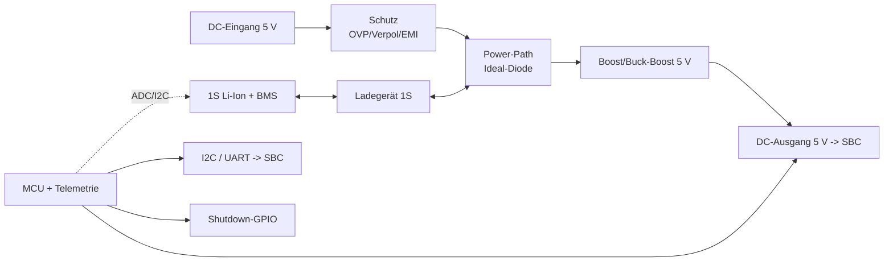

# TinyUPS – Architektur (Entwurf)

> Status: **Entwurf**. Blöcke und Topologie sind als Vorschlag zu verstehen und
> werden nach Klärung der offenen Fragen in `requirements.md` fixiert.

## Blockschaltbild



## Funktionsblöcke

| Block | Aufgabe | Kandidaten |
| --- | --- | --- |
| Eingangsschutz | Verpol-, Überspannungs-, Transientenschutz | TVS, P-MOSFET, eFuse |
| Power-Path | Priorität Eingang vs. Batterie, Rückspeiseschutz | Ideal-Diode-Controller |
| Ladegerät | 1S Li-Ion CC/CV, Terminierung | z. B. BQ2407x, BQ25xxx, TP4056-Klasse |
| DC/DC | 5 V stabil, hoher Wirkungsgrad | Boost- bzw. Buck-Boost-Wandler |
| BMS/Schutz | Über-/Tiefentladung, Übertemperatur | Zellschutz-IC oder geschützte Zelle |
| MCU | Messung, Statuslogik, Telemetrie | ESP32-C3 / STM32G0 / RP2040 |
| Messung | V/I der Zelle und des Ausgangs | Shunt + INA219/INA226 o. ä. |
| Telemetrie | Status zum SBC | I²C-Register, UART/USB-CDC |

## Verzeichnisstruktur (geplant)

```
hardware/
  tinyups.kicad_pro      # KiCad-Projekt
  tinyups.kicad_sch      # Schaltplan
  tinyups.kicad_pcb      # Layout
  tinyups.kicad_dru      # Design-Regeln (Fertiger)
  libs/                  # eigene Symbole/Footprints
firmware/
  ...                    # MCU-Firmware (PlatformIO/Zephyr)
sim/
  *.cir                  # ngspice-Netzlisten
tests/
  test_*.py              # pytest + PyVISA (Bring-up/Abnahme)
docs/
  requirements.md
  architecture.md
  test-plan.md
  decisions/
```

## Wichtige Design-Entscheidungen

- **Unterbrechungsfreie Umschaltung** über Ideal-Diode / Power-Path statt
  mechanischem Relais.
- **Getrennte Regelkreise** für Laden und Ausgangswandlung.
- **Telemetrie auf separatem MCU**, damit das Verhalten unabhängig von der
  SBC-Software beobachtbar/testbar ist.
- **Alle Checks per CLI** (`kicad-cli`, KiBot, ngspice) für CI und Agent-Support.
