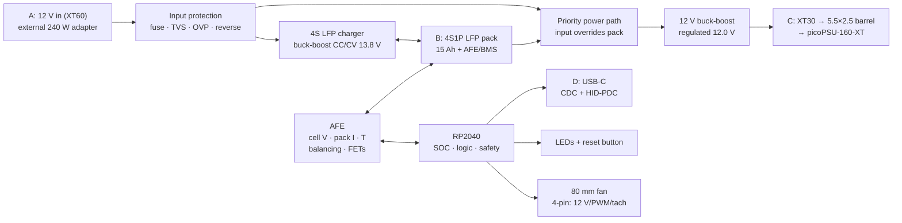

# TinyUPS – Architecture (Draft)

> Status: **Draft.** Block topology is fixed by the design interview
> (see `docs/requirements.md`); component selection is still open.

## Block diagram



## Why this topology

- **Priority power path, not an ideal-diode OR.** A charged 4S LFP pack
  (~13.8 V) is *higher* than the 12 V input. A passive OR would let the pack
  supply the load even on mains and cycle the battery. The path must actively
  prefer the input whenever it is valid.
- **Always-regulated 12 V output.** The pack ranges from ~11.2 V to 13.8 V, so
  a buck-boost keeps the picoPSU inside its 10.8–13.2 V window at all times and
  hides adapter sag.
- **Buck-boost charger.** The pack sits both above and below 12 V depending on
  SOC, so a boost-only charger cannot regulate a low pack; a 4-switch
  buck-boost covers the whole range.
- **Two independent paths on mains** (load from input, pack charged in
  parallel) keep the transfer seamless and let the 20 A adapter run the load
  and charge simultaneously.
- **Pack-integrated BMS.** Per-cell sensing, protection and balancing live on
  the PCB so the module is self-contained and reports richer telemetry.

## Functional blocks

| Block | Task | Candidates |
| --- | --- | --- |
| Input protection | Fuse, reverse-polarity, OVP, transient | Fuse + TVS + P-FET / eFuse |
| Priority power path | Prefer input, disconnect pack on mains | Power mux / back-to-back FETs + controller |
| Charger | 4S LFP CC/CV to 13.8 V, temp-limited | 4-switch buck-boost charger IC |
| Output converter | Regulated 12.0 V, ≥ 15 A | Synchronous buck-boost controller |
| Battery management | Cell V, pack I, T, balancing, protection FETs | BQ769x2-class AFE + dual N-FETs |
| Measurement | Output V/I, temperatures | AFE / INA226 + NTC |
| MCU | SOC, state machine, telemetry, signalling | RP2040 + QSPI flash |
| Host link | Telemetry + low-battery shutdown | USB-C composite CDC + HID-PDC |
| User interface | Status indication, reset | LEDs + button |
| Cooling | Temperature-controlled airflow | 80 mm fan, on-board 4-pin header |

## Modes

1. **Mains, pack charged** – load from input, pack idle/float.
2. **Mains, pack charging** – load from input, charger in CC or CV.
3. **Backup** – input absent, pack feeds the buck-boost, no host reset.
4. **Low battery** – host warned at ≤ 30 % SOC; force-off at 3.0 V/cell.
5. **Off / storage** – output disabled, ≤ 1 mA from pack.

## Directory structure (planned)

```
hardware/
  tinyups.kicad_pro      # KiCad project
  tinyups.kicad_sch      # schematic
  tinyups.kicad_pcb      # layout
  tinyups.kicad_dru      # design rules (JLCPCB)
  libs/                  # custom symbols/footprints
mechanical/
  enclosure/             # ATX-bay enclosure (STEP/STL)
firmware/
  ...                    # RP2040 firmware (Pico SDK / PlatformIO)
sim/
  *.cir                  # ngspice netlists
tests/
  test_*.py              # pytest + PyVISA bring-up / acceptance
docs/
  requirements.md
  architecture.md
  bom.md
  test-plan.md
  datasheets/            # vendor datasheets + source register
  decisions/
```

## Key design decisions

- Priority (active) power path instead of ideal-diode OR.
- Separate loops for charging and output conversion.
- Pack-integrated AFE for telemetry and safety.
- Telemetry and shutdown on a dedicated MCU, independent of host software.
- USB composite device: CDC for tooling, HID-PDC for native OS/NUT support.
- All checks headless via CLI (`kicad-cli`, KiBot, ngspice) for CI and
  agent support.

See `docs/decisions/0002`–`0006` for the recorded choices.
